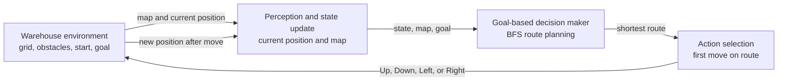

# Task 2: Goal-Based Warehouse Agent Design

This design follows the fixed, known warehouse map and movement rules specified
in [Task 1](task1_problem_specification.md). It describes the agent before its
implementation.

## Agent components

| Component | Design |
|---|---|
| **Environment** | A fixed 7-row by 21-column grid. `#` cells are blocked; `.` cells are traversable; `S` is the loading-bay start at `(1, 1)`; and `G` is the dispatch goal at `(1, 19)`. The outer border is blocked. |
| **Current state** | The vehicle's current `(row, column)` position. During planning, the search also records discovered positions, their predecessors, and which positions remain to be explored. |
| **Goal** | Reach the cell `(1, 19)` without entering an obstacle. Among valid routes, find a route with the fewest moves. |
| **Available actions** | Move one cell Up, Down, Left, or Right. A move is legal only when the destination cell is inside the grid and traversable. |
| **Decision-making component** | Breadth-first search (BFS) over the grid. It expands legal neighboring cells, records each cell's predecessor, and stops when it reaches the goal. Reconstructing the predecessor chain yields a shortest route because each move has equal cost. The agent selects the first move on that route, then plans again from its updated position. |

## Interaction diagram

The environment provides the map and the vehicle's current position to the
state update component. The decision maker uses that state, the map, and the
goal to compute a route. The action selector issues the route's next legal
move. The environment applies the move and returns the new position, allowing
the agent to repeat the cycle until it reaches the goal. If no route exists,
the decision maker reports that the goal is unreachable and issues no move.

## Why BFS fits this design

The map is finite, movement is restricted to four neighboring cells, and all
moves have equal cost. BFS is complete on this finite graph and returns a
shortest path when one exists. It is simple for this small warehouse map and
does not require a heuristic. For larger maps, A* with Manhattan distance is
an alternative that can reduce the number of explored cells while preserving
shortest-path behavior under these movement and cost rules.
